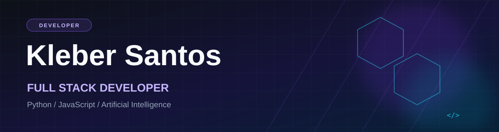

## Sobre mim

Sou **Kleber Santos**, desenvolvedor **Full Stack** com foco em aplicações web modernas, APIs estruturadas e soluções que integram **Python, dados e Inteligência Artificial**.

Participo do programa **Start Tech da TOTVS** e estou na reta final da minha graduação na **UNIP**. Tenho interesse em conectar interfaces intuitivas a back-ends robustos e explorar tecnologias como **FastAPI, LangChain e RAG** para resolver desafios reais.

Busco evoluir continuamente por meio da prática, de imersões de desenvolvimento — incluindo iniciativas da **Alura** — e do contato com a comunidade de tecnologia em eventos como o **The Developer's Conference (TDC)**.

## Tecnologias e ferramentas

**Frontend**

**Backend e APIs**

**Banco de dados e serviços**

**Inteligência Artificial e dados**

**Ferramentas de desenvolvimento**

## Atividade no GitHub

## Contribuições

  <picture>
    <source media="(prefers-color-scheme: dark)" srcset="https://raw.githubusercontent.com/dev-Kleber-santos/dev-Kleber-santos/output/github-contribution-grid-snake-dark.svg" />
    <source media="(prefers-color-scheme: light)" srcset="https://raw.githubusercontent.com/dev-Kleber-santos/dev-Kleber-santos/output/github-contribution-grid-snake.svg" />
    
  </picture>

## Vamos nos conectar?

Estou sempre aberto a trocar experiências, aprender e conversar sobre desenvolvimento de software, dados e Inteligência Artificial.

Desenvolvimento Full Stack | Python | Inteligência Artificial

